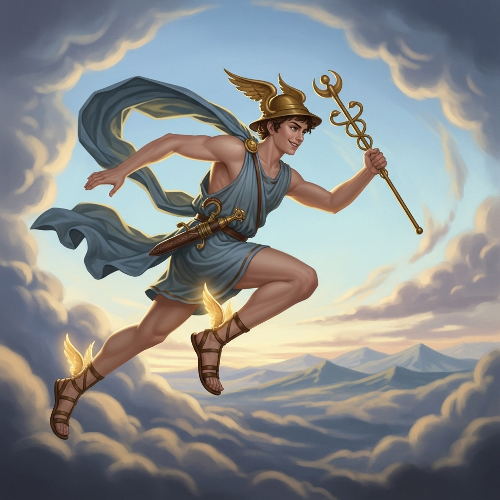

# Hermes

A lightweight desktop API client for testing HTTP requests, built with Electron. Named after the Greek messenger god.

<p align="center">
  
</p>

## Download

Grab the latest Windows installer from the [Releases page](https://github.com/Cedric-Raichand/Hermes/releases/latest) and run `Hermes.Setup.x.x.x.exe`.

> Windows may show "Windows protected your PC" because the installer isn't code-signed. Click **More info**, then **Run anyway**.

## Features

- Send **GET, POST, PUT, PATCH and DELETE** requests
- **Query params table** that stays in sync with the URL, with a checkbox to switch each param on or off
- **Headers and body editors**
- Response viewer with **pretty-printed JSON**, a **headers tab**, and a colour-coded status line showing status, time and size
- **Saved requests** that persist between launches
- **Request history** (last 50 requests), reloadable with one click
- **Ctrl+Enter** to send from anywhere
- Requests are sent from Electron's main process, so browser CORS rules don't get in the way
- All data is stored locally on your machine

## Run from source

Requires [Node.js](https://nodejs.org/).

```bash
git clone https://github.com/Cedric-Raichand/Hermes.git
cd Hermes
npm install
npm start
```

## Build the installer

```bash
npm run dist
```

The installer is created in the `dist` folder.

## Project structure

| File | Purpose |
| --- | --- |
| `main.js` | Main process: creates the window, sends requests, stores saved requests and history |
| `preload.js` | Safe bridge between the main process and the UI |
| `index.html` | App layout |
| `styles.css` | Styling |
| `renderer.js` | UI logic: tabs, params sync, saved requests, history |

## Built with

- [Electron](https://www.electronjs.org/)
- [electron-builder](https://www.electron.build/)
- Plain JavaScript, HTML and CSS

## Roadmap

- Environment variables
- Collections and folders
- Auth helpers (Bearer, Basic)
- Custom app icon
- Auto-updates

## License

ISC
